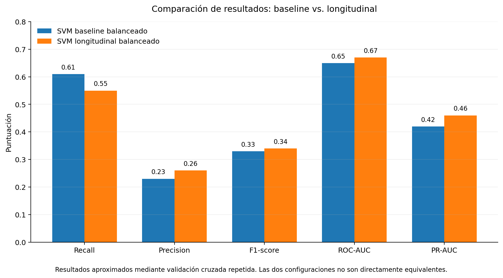

# ¿Puede el Machine Learning anticipar la demencia?

### Un estudio exploratorio con datos longitudinales de OASIS-2


> Este proyecto comenzó intentando responder si el Machine Learning podía ayudar a detectar el Alzheimer antes de la aparición de los síntomas. El análisis de los datos obligó a reformular esa pregunta y terminó convirtiéndose en un estudio sobre las posibilidades —y las limitaciones— de los modelos clásicos de Machine Learning para identificar patrones asociados a la conversión posterior a demencia.


## 🧠 Motivación

Este proyecto nace de una motivación personal. Una persona muy cercana a mí fue diagnosticada de Alzheimer y, al mismo tiempo que intentaba comprender mejor la enfermedad, surgió una pregunta relacionada con mi formación en Ciencia de Datos:

> **¿Podría el Machine Learning ayudar a detectar el Alzheimer antes de la aparición de los síntomas?**

Al comenzar a trabajar con **OASIS-2**, quedó claro que el tamaño de la muestra, las variables disponibles y el diseño del estudio no permitían responder rigurosamente a una pregunta tan ambiciosa.

Por ello, el objetivo evolucionó hacia una cuestión más ajustada a los datos:

> **¿Hasta qué punto pueden los modelos clásicos de Machine Learning ayudar a diferenciar a los pacientes que permanecen sin demencia de aquellos que posteriormente presentan conversión a demencia?**


## 📊 Datos

El proyecto utiliza **OASIS-2 (Open Access Series of Imaging Studies – Longitudinal)**, un dataset longitudinal formado por:

- **150 participantes**
- **373 sesiones**
- Entre **2 y 5 visitas por participante**
- Información demográfica, cognitiva, clínica y medidas derivadas de resonancia magnética

Los participantes se clasifican como **Nondemented, Demented o Converted**.

Para el problema de Machine Learning centrado en la conversión se compararon los grupos **Nondemented y Converted**, con una cohorte de 86 participantes: 72 Nondemented y 14 Converted.

> Los datos originales de OASIS-2 no se incluyen en este repositorio debido a sus condiciones de uso.


## 🔬 Metodología

El proyecto se desarrolló progresivamente:

**Comprensión de los datos → EDA baseline → EDA longitudinal → ML baseline → ML longitudinal**

En el análisis baseline se estudió la información disponible en la primera visita y se evaluaron tres modelos clásicos:

- Regresión Logística
- Random Forest
- Support Vector Machine (SVM)

Debido al fuerte desbalance de clases, se compararon modelos estándar y balanceados y se utilizaron métricas como **Recall, Precision, F1-score, ROC-AUC y PR-AUC**, además de accuracy.

Posteriormente se incorporó la evolución de **MMSE y nWBV** para estudiar si la información longitudinal permitía diferenciar mejor las trayectorias de Converted y Nondemented.

El análisis longitudinal se interpreta como **clasificación retrospectiva de trayectorias, no como predicción precoz**, ya que utiliza información obtenida durante el seguimiento.


## 📈 Resultados principales

El análisis mostró un importante solapamiento entre **Nondemented y Converted en la visita inicial**, lo que dificultó anticipar qué participantes presentarían posteriormente conversión.

Los modelos no balanceados alcanzaban accuracies cercanas al **83 %**, pero prácticamente no identificaban participantes Converted, mostrando por qué la accuracy puede resultar engañosa en problemas desbalanceados.

Entre las configuraciones evaluadas, los resultados aproximados de los SVM balanceados fueron:

| Métrica | Baseline | Longitudinal |
|---|---:|---:|
| Recall | 0.61 | 0.55 |
| Precision | 0.23 | 0.26 |
| F1-score | 0.33 | 0.34 |
| ROC-AUC | 0.65 | 0.67 |
| PR-AUC | 0.42 | 0.46 |



> **Resultado principal:** los modelos encontraron cierta señal relacionada con la conversión a demencia, pero no alcanzaron una capacidad suficientemente robusta y estable para realizar una predicción individual fiable.

La incorporación de información longitudinal tampoco produjo una mejora sustancial. Aunque el cambio anual de MMSE mostró diferencias entre grupos, estas diferencias no se tradujeron en una separación predictiva suficientemente sólida.


## 💡 Conclusión

Con la muestra y las variables estructuradas utilizadas en este proyecto, los modelos clásicos de Machine Learning evaluados **no permiten anticipar de forma fiable qué pacientes desarrollarán posteriormente demencia**.

El resultado pone de manifiesto una idea importante en Data Science aplicada a salud: **la complejidad del algoritmo no puede compensar las limitaciones de los datos**.

Problemas clínicos de esta complejidad probablemente requieren cohortes mayores y una combinación más rica de información clínica, cognitiva, neuroimagen y otros biomarcadores.

Más que obtener un modelo predictivo final, este proyecto ha permitido explorar de forma crítica **hasta dónde podemos llegar con los datos disponibles y dónde aparecen sus límites**.

> Este proyecto tiene una finalidad exclusivamente exploratoria y educativa. Los modelos desarrollados no constituyen una herramienta diagnóstica ni tienen aplicación clínica.


## 📓 Notebooks

| Notebook | Contenido |
|---|---|
| [01 - Understanding & Initial EDA](notebooks/01_Understanding_and_Initial_EDA_OASIS2.ipynb) | Comprensión del dataset y primeras exploraciones. |
| [02 - EDA Baseline](notebooks/02_EDA_Baseline.ipynb) | Análisis de la primera visita. |
| [03 - EDA Longitudinal](notebooks/03_EDA_Longitudinal.ipynb) | Evolución de MMSE, nWBV y otras variables durante el seguimiento. |
| [04 - ML Baseline](notebooks/04_ML_Baseline.ipynb) | Modelos para estudiar la conversión utilizando información inicial. |
| [05 - ML Longitudinal](notebooks/05_ML_Longitudinal.ipynb) | Clasificación utilizando información de la evolución longitudinal. |


## 📂 Acceso a los datos

El dataset **OASIS-2 no se distribuye junto con este repositorio**.

Para reproducir el proyecto es necesario solicitar acceso a través de la página oficial de OASIS:

https://sites.wustl.edu/oasisbrains/datasets/

Tras obtener los datos, el archivo utilizado para el análisis debe guardarse localmente como:

```text
data/oasis_2.xlsx
```

Las dependencias necesarias pueden instalarse mediante:

```bash
pip install -r requirements.txt
```

Los notebooks deben ejecutarse en orden del `01` al `05`.


## 📚 Agradecimientos y referencias

### Acknowledgments

“Data were provided [in part] by OASIS [insert appropriate OASIS source info]”

b. OASIS-2: Longitudinal: Principal Investigators: D. Marcus, R, Buckner, J. Csernansky, J. Morris; P50 AG05681, P01 AG03991, P01 AG026276, R01 AG021910, P20 MH071616, U24 RR021382

### Citation

b. OASIS-2: Longitudinal: https://doi.org/10.1162/jocn.2009.21407


## 👩‍💻 Autora

**Marta Gan Sáez**

Proyecto desarrollado como parte de mi formación y especialización en Ciencia de Datos e Inteligencia Artificial aplicada a salud.